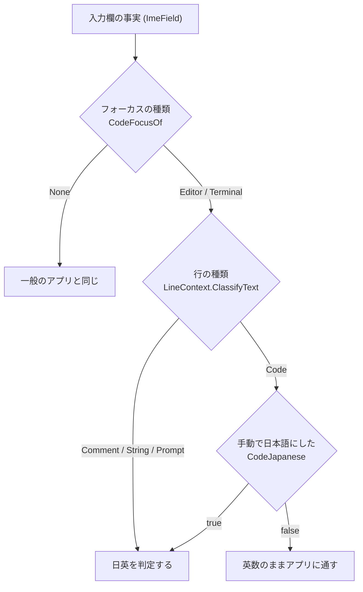

# コード入力の設計

アプリの種類が「コード」の入力欄 (コードエディター・ターミナル) で、キーを英数のままアプリに通すか、日本語として判定するかを決める仕組み。
判断はすべて `src/Meltype.Core` にあり、どの OS のフロントエンドも同じ動きになる。

使い方は [USAGE.md](../USAGE.md#コードエディターとターミナル)。

## 判断の流れ

| 段階 | 場所 | 入力 | 結果 |
| --- | --- | --- | --- |
| フォーカスの種類 | `ImeSession.CodeFocusOf`・`LineContext.ClassifyFocus` | アプリ別設定の種類、ウィンドウのタイトル、UI Automation の要素の名前・クラス、`ImeTrait.Terminal` | `CodeFocus` (`None`・`Editor`・`Terminal`) |
| 行の種類 | `LineContext.ClassifyText` | キャレットより前の文字列、ターミナルか、コメントの設定 | `LineKind` (`Code`・`Comment`・`String`・`Prompt`) |
| キーの扱い | `ImeSession.ComposeKey` | 行の種類、`CodeJapanese` | アプリに通すか、変換ボックスに入れるか |

入力モードの表示 (「あ」「A」) も、同じ判断 (`ShowsJapanese`・`CodeEnglishAt`) から出す。キーの扱いと表示を別々に決めないこと。

## フォーカスの種類

- アプリ別設定の種類が「コード」でなければ `None`。ターミナルの OS の知らせ (`ImeTrait.Terminal`。IBus・fcitx5・meltype-tty が送る) は種類によらず `Terminal`。
- タイトルが文章のファイル (`.md`・`.txt` など。`IsDocumentTitle`) なら `None`。
- 要素の名前がチャット・AI の入力欄 (`ChatWords`) なら `None`。ターミナルのアプリ (`TerminalProcesses`) か、名前・クラスがターミナルなら `Terminal`。
- Electron のエディター (VS Code など) は、要素の名前がエディター・検索でなければ `None` (設定の画面など)。
- VS Code の補完の一覧 (`monaco-list-row`) にフォーカスが移っただけなら、種類を変えない (打った文字はエディターに入るため)。

## 行の種類

キャレットより前の今の行を左から読む (`Classify`)。前の行も届いたときは、先に、前の行から続いて閉じていない `"""`・`'''`・`/* … */`・`<!-- … -->` を探す (`OpenBlock`)。

| 種類 | 条件 |
| --- | --- |
| `Prompt` | ターミナルの AI の入力行 (`> `・`› `。枠線の `│` は飛ばす)。コメントの設定に関係しない |
| `String` | 閉じていない `"`・`'`・`` ` ``。`'` は英単語の中 (`don't`) では文字列の始まりにしない。コメントの設定に関係しない |
| `Comment` | 設定 (`CodeComment*`) で ON のコメントの記号の後ろ。記号ごとの条件は `LineContext.Classify` |
| `Code` | それ以外 |

決まりの理由:

- ターミナルでは記号を打っただけではコメントにしない。`--all`・`//src:app` のような引数を、打ち終わるまで英数のまま通すため。記号の後に空白を打った時点でコメントになる。
- 「直後が ASCII 以外」もコメントにするのは、`#` の直後に日本語を確定したあと (`#日本語`) もコメントのままにするため。
- URL (`https://`・`s3://` など) の中の `//`・`/*` はコメントにしない (`UrlLength`)。
- OFF の記号はコードとして読み、その後ろにある ON の記号や文字列も調べる (`--` が OFF でも `-- "` の後ろは文字列)。
- `OpenBlock` が行末まで飛ばすのは、実際に行コメントになった記号の後ろだけ。OFF の記号やターミナルの引数の `//` の後ろにある `/*` も調べる (`//` が OFF なら、`// /* 説明` の次の行は `/* … */` の中)。`bazel build //src/work/*` の `/*` は語の先頭にないので、ターミナルではコメントにならない。

コメントの中で `//` に続けて打った `/`・`!` などの記号 (`///`・`//!`・`//----`) は、本文ではないので日本語の記号にしない (`ContinuesSlashCommentMarker`)。文字列を閉じる引用符は、変換中の文字を確定してから英数のままアプリに通す。

### `#` の指令と属性

`#region `・`#error `・`#warning ` は、見出しや診断文を日本語でも書けるようコメントとして扱い、`#!`・`#[` はシバンや属性を打つためコードとして扱う。指令の開始位置はエディターでは行頭、ターミナルでは語頭とする。それ以外の `#` は通常の規則 (`IsHashComment`) で判断する。

- **指令の開始位置 (`IsHashDirectiveStart`)**: エディターでは、同じ行で閉じたブロックコメント (`/* … */`) と空白だけが前にある位置。ターミナルでは、通常の `#` コメントと同じ語頭 (行頭か空白の後) とする。プロンプトの文字列は推測しない。前の行から続くブロックコメントの途中・閉じた直後は、どちらでも指令にしない。
- **指令の本文 (`IsHashDirectiveMessage`)**: 上記の 3 指令は、大文字小文字を区別して直後の半角空白まで一致し、`CodeCommentHash` が ON のときコメントとする。`#include<stdio.h>`・`#foo`・`kome #TODO` などは従来どおりコード。文字列や他のコメントの中の `#` は指令にしない (補間構文などは解析しない)。
- **前の行の走査 (`OpenBlock`)**: 通常の `#` は従来どおり `terminal: false` で行末まで飛ばす。実行済みコマンド (`echo $# /* 説明` など) にある `/*` や引用符を、次のプロンプトまで持ち越さないため。指令も、ターミナルを含めてエディターの行頭の規則で読む。語頭の規則にすると、``echo `cmd #region ` /* 説明`` のように引用符の中の `#region` が後ろの `/*` まで飛ばしてしまう。
- **直後の `!`・`[` の通過 (`ContinuesHashDirectiveMarker`)**: `ImeSession.ComposeKey` はエディターで、未確定入力も手動の日本語入力もないローマ字入力のとき、指令の行頭にある `#` の直後の `!`・`[` を元のキーとして通す。エディターの括弧補完などを効かせるため。かな入力では記号キーもかなに使うため、この処理はしない。ターミナルや `CodeCommentHash` OFF では裸の `#` が既にコードなので、通常のコード入力として通る。

## 状態

コード入力の状態は `ImeSessionState` が持つ。ほかの判断はすべて、上の事実から毎回求める。

`CodeJapanese` は改行では OFF にしない (複数行のコメントを続けて書くため)。ターミナルは出力でもキャレットが動くので、キーを伴わない移動では OFF にしない。

### キャレットの前が届かない入力欄

Windows Terminal (TSF は文書を持たない)・iTerm2 (日本語を出したあとは読めない) などは、キャレットの前を渡さない。そのときだけ、Meltype が確定・通過させた文字から今の行 (`Line`) を作って使う (`LineBefore`・`TrackLine`、#1687)。
これは本体が入力欄の中身を推測する唯一の例外で、ほかの判断には使い回さない。キャレットの前がまったく分からないとき (`before` が null) は、コードの行とみなす。

## 設定

コメントの記号ごとの ON / OFF (`CodeCommentSlash` など 6 つ、既定はすべて ON) だけを持つ。言語の選択やアプリ別の記号は持たない。
設定は `env.App` (アプリ別設定を反映したもの) から毎回読むので、変えると入力欄に入り直さなくても次のキーから効く。

## 変えるとき

- 行の種類の期待は `src/Meltype.Core.Tests/FeedbackTests.cs` (`CodeProfileTests`) と `QualityTests.cs` の `CodeLines`、キーの扱いと表示は `SessionFacadeTests.cs` の `CodeInput_*` に書く。
- 記号の決まりを変えたら、エディターとターミナルの両方、ON と OFF の両方で確かめる。
- 利用者向けの説明は [USAGE.md](../USAGE.md#コードエディターとターミナル) にまとめ、OS ごとの文書からはそこへリンクする。
