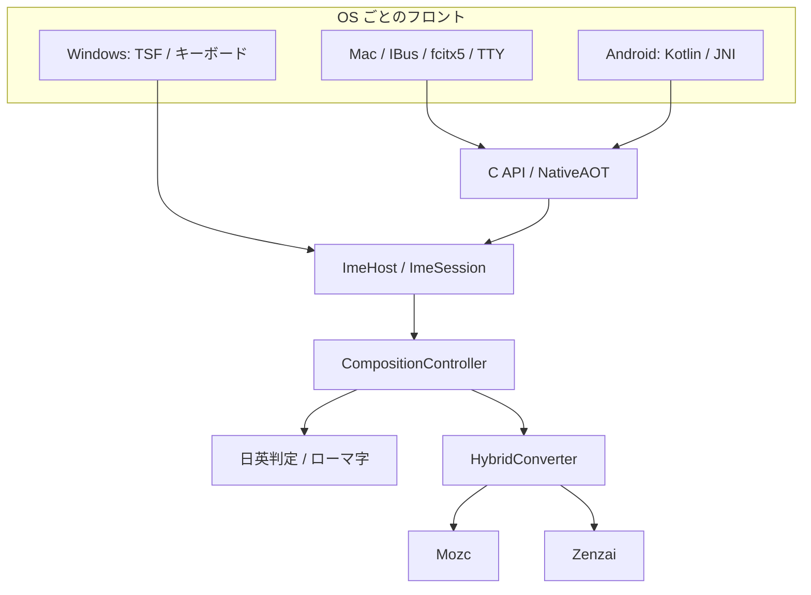

# Meltype の開発

ソースからのビルド、テスト、配布用のパッケージ、動作の仕組みです。全体の案内は [文書一覧](../README.md) にあります。

文書は main の実装を説明します。公開済みの版との差は [リリースノート](../release-notes/) で確認してください。
使い方は [USAGE.md](../USAGE.md)、貢献の方法は [CONTRIBUTING.md](../../CONTRIBUTING.md)、リリースの手順は [RELEASE.md](RELEASE.md) にあります。

## フォルダーの構成

| フォルダー | 中身 |
|---|---|
| `src/Meltype.Core/` | 入力の判断を受け持つ部分 (Windows・Mac・Linux・TTY・Android 共通)。英語 / 日本語の判定・ローマ字・変換ボックスの中身・辞書・学習・設定 |
| `src/Meltype.Windows/` | Windows 版 (キーボードフック・変換ボックスの画面・IMM32 / TSF・UI Automation・トレイ) |
| `src/Meltype.Core.CApi/` | Mac・Linux・TTY・Android 版から呼ぶ C の関数 (Meltype.Core を NativeAOT で dylib・so にする) |
| `tui/` | Linux の pty で動く端末版 (`meltype-tty`、Python) |
| `android/` | Android のソフトウェアキーボード (Kotlin・JNI・NativeAOT) |
| `src/Meltype.Settings/` | 設定アプリ (Windows・Mac・Linux 共通、Avalonia)。設定・ユーザー辞書・定型文・学習データ・バックアップ。各 OS のビルドが NativeAOT で同梱する |
| `mac/` | Mac 版の IME (Swift、Input Method Kit) |
| `linux/` | Linux 版 (IBus・fcitx5 のエンジン) |
| `native/` | Meltype IME (Windows の TSF の DLL)・Mozc ヘルパー・Zenzai の取得とビルド ([native/mozc/README.md](../../native/mozc/README.md)。Mozc-UT の辞書は [MOZC-UT.md](MOZC-UT.md)) |
| `src/Meltype.Core.Tests/` | 共通部分のテスト (判定・変換ボックス・学習・品質テスト)。Mac・Linux でも動く |
| `src/Meltype.Windows.Tests/` | Windows 版のテストと調査用の道具 (共通部分のテストもまとめて流す) |
| `src/Meltype.Benchmark/` | 打鍵の処理の計測 ([README](../../src/Meltype.Benchmark/README.md)) |
| `dictionaries/` | 組み込みの辞書 |
| `tools/` | 辞書の生成と検査 |
| `packaging/` | 配布用のファイル (インストーラー・自動更新・Meltype IME の登録) |
| `web/` | 公式サイトと報告フォーム (Cloudflare Workers) |
| `docs/` | 利用者向けの文書 (使い方・OS ごとの説明)。`docs/release-notes/` はリリースノート |
| `docs/dev/` | 開発者向けの文書 (開発・設計・リリースの手順) |

`src/Meltype.Core/` の中は、次のように分かれています。参照の向きは AGENTS.md の「構成」のとおりです。

- `Ime/`: `ImeHost`・`ImeSession` (入力の判断を受け持ち、各 OS のフロントはこれを呼ぶ)・部品の組み立て (`MeltypeRuntime`)・コードの行の判定
- `Composition/`: 変換ボックスの中身 (変換の流れ・候補・文脈・確定・学習の呼び出し)。`Composition/Utility/` はユーティリティ変換 (計算・日付・再生中の曲など)
- `Detection/`: ローマ字・英語・辞書・かなの判定と、英語か日本語かの学習
- `Learning/`: 変換の学習と予測変換
- `Engine/`: 変換エンジン (Mozc・Zenzai)
- `Dictionary/`: ユーザー辞書・補助辞書・英訳・意味・もしかしての辞書・スニペット
- `Libraries/Chars/`・`Libraries/Lexicon/`: どこからでも使う文字の判定と、同梱の辞書の読み込み
- `Input/`・`Config/`・`Diagnostics/`: キーの表し方・設定・ログと誤判定の報告

## Windows でビルドして試す

```powershell
powershell -ExecutionPolicy Bypass -File .\Install-Meltype.ps1
```

配布用のインストーラーを作り ([配布用のパッケージを作る](#配布用のパッケージを作る))、それで `%LOCALAPPDATA%\Programs\Meltype` に入れて起動します。配布するものと同じ経路で入るので、自動更新とも同じ場所です。
`-NoIme` を付けると、Meltype IME を新しく登録しません (登録済みなら、インストーラーが更新します)。
`-ExecutionPolicy Bypass` はこのコマンドにだけ効き、PC 全体の設定は変えません。

アンインストールは、ふつうに入れたときと同じく、「Meltype」の最初のページの「アンインストール…」か Windows の「設定」→「アプリ」です。

必要なもの:

- Windows 10 / 11 (x64)、Windows 11 (ARM64)
- .NET 10 SDK
- Inno Setup 6 (インストーラーを作ります。無ければ Chocolatey で入れます)
- Visual Studio (Build Tools でもよい) の「C++ によるデスクトップ開発」(Meltype IME の DLL を作ります)

Meltype IME の DLL と、それに要る Visual Studio Installer の「個別のコンポーネント」:

| 作るもの | 作る DLL | 要るコンポーネント |
| --- | --- | --- |
| x64 の PC で `Install-Meltype.ps1` | x64・x86 | MSVC x64/x86 ビルド ツール (最新)・Windows 11 SDK |
| ARM64 の PC で `Install-Meltype.ps1` | ARM64X・x86 | 上に加えて MSVC ARM64/ARM64EC ビルド ツール (最新) |
| 配布用のパッケージ (`Build-Package.ps1`) | x64・ARM64X・x86 (1 つでも失敗したら止まる) | ARM64 の PC と同じ |
| ポータブル版 (`Build-Package.ps1 -Portable`) | 作らない | 要らない |

`Install-Meltype.ps1 -NoIme` も DLL を作って入れます (`-NoIme` は Meltype IME を新しく登録しないだけで、登録済みなら更新し、アンインストールで外すため)。

`native\tip\build.ps1` は、ARM64 のビルドツールを `vswhere` でコンポーネント ID `Microsoft.VisualStudio.Component.VC.Tools.ARM64` から探します。
これは「(最新)」の付いたコンポーネントで、版の付いた ARM64 ビルドツール (「v14.xx」など) だけを入れていると見つかりません。
「Visual Studio の C++ ビルドツールが見つかりません」と出たら、次で確かめてください (何も出なければ、上のコンポーネントを入れる)。

```powershell
& "${env:ProgramFiles(x86)}\Microsoft Visual Studio\Installer\vswhere.exe" -latest -products * -requires Microsoft.VisualStudio.Component.VC.Tools.ARM64 -property installationPath
```

## Mac・Linux・TTY・Android でビルドする

- Mac 版: [mac/README.md](../../mac/README.md)
- Linux 版 (WSL を含む): [linux/README.md](../../linux/README.md)
- TTY 版: [tui/README.md](../../tui/README.md)
- Android 版: [android/README.md](../../android/README.md#ビルド)

## テスト

```powershell
dotnet build Meltype.sln
dotnet run --project src/Meltype.Windows.Tests                                   # すべてのテスト (Windows)
dotnet run --project src/Meltype.Windows.Tests -- CompositionTests               # 名前に一致するテストだけ
dotnet run --project src/Meltype.Windows.Tests -- --explain konnichiwa hello      # 1 文字ずつの判定理由 (英数状態の検知)
dotnet run --project src/Meltype.Windows.Tests -- --eval                          # 品質テスト
```

### Mac・Linux でのテスト

OS に依存しない部分 (`src/Meltype.Core`) とそのテストは、Mac・Linux でも動きます。.NET 10 SDK を入れて次を実行します。GitHub Actions でも、Ubuntu と macOS で毎回流しています。

```bash
dotnet run --project src/Meltype.Core.Tests                 # すべてのテスト
dotnet run --project src/Meltype.Core.Tests -- --eval       # 品質テスト
dotnet run --project src/Meltype.Core.Tests -- --version    # 版 (Meltype.Core)
dotnet run --project src/Meltype.Core.Tests -- --repro kyouhagoogle enter   # 打ったときの見え方と確定の結果
dotnet run --project src/Meltype.Core.Tests -- --repro 26niti space --learn "niti → （日）"  # 先に niti を （日） と確定して学習させてから打つ (--learn は 5 つまで)
dotnet run --project src/Meltype.Core.Tests -- --mixed-bench out.json       # 日本語の文の中の英単語が正しく分かれるか (約 550 例)
dotnet run --project src/Meltype.Core.Tests -- --expect src/Meltype.Core.Tests/data/issue-cases.tsv out.json  # 報告された誤変換 (MELTYPE_MOZC が要る)
dotnet run -c Release --project src/Meltype.Core.Tests -- --perf perf.json  # 変換エンジンの遅延 (p95 / p99)・候補の数・控え・メモリ・正解率 (MELTYPE_MOZC が無ければ判定のみ)
```

漢字変換を含めて調べるときは、環境変数 `MELTYPE_MOZC` に実行可能なヘルパーのパスを指定します。未指定の `--repro` はかなのまま確定し、`--expect` はエラーになります。`--perf` は未指定なら判定のみの計測です。最新の公開版の zip から取り出す方法とパスは [AGENTS.md](../../AGENTS.md#ビルドとテスト) にあります。ヘルパーのソースや `MOZC_COMMIT` を変えたときにだけ、[手元でビルド](../../native/mozc/README.md) します。

`--repro` で Zenzai も比べるには、`MELTYPE_ZENZAI_SERVER` に llama-server、`MELTYPE_ZENZAI_MODEL` に zenz の GGUF を指定します。

Windows のアプリ本体・Mac / Linux の IME も同じ形で版を出せます (`Meltype.exe --version`、`Meltype.app/.../Meltype --version`、`ibus-engine-meltype --version`)。
Windows のアプリ本体は GUI アプリ (WinExe) なので、cmd では版がプロンプトの後に出ます。
コンソールアプリ (Exe) にすると、エクスプローラーやタスク スケジューラから起動したときにコンソールの窓が一瞬フォーカスを取り、その間に打ったキーが消えるので、WinExe のままにしています。

`src/Meltype.Core.Tests/data/issue-cases.tsv` は、GitHub の issue (open / closed) から「打ったもの」と「期待した結果」を取り出したコーパスです。判定の作り方に関係なく同じ物差しで比べられるので、判定を変えるときは `--eval` と合わせて `--expect` で流します。

`--mixed-bench` は `MELTYPE_BENCH_OFFSET=31` などで調べる語を変えられます。

機能を足す前と後で変換エンジンの速さ・精度を比べるときは、両方の版で `--perf` を動かして `--perf-compare 前.json 後.json` で比べます。測る項目と比べ方は [src/Meltype.Benchmark](../../src/Meltype.Benchmark/README.md) にあります。

### 品質テスト

`src/Meltype.Core.Tests/QualityTests.cs` に、日本語の文・英文・混在・英語とも日本語とも読める語・英語の後の短い語・記号と数字・小書き文字・大文字・かな入力・コードの行・文章ファイル・絵文字・もしかして の例をまとめてあります。
期待値は説明できる仕様と実装が満たす結果に合わせ、未実装の理想はコメントに残します。`--eval` でカテゴリーごとの正解率と外れた例を表示します。

- 通常のテストでは、全体 95% 以上・どのカテゴリーも 80% 以上を基準にしています (ある直しで別の場所が壊れたら気づけるように)
- Pull Request では「精度の比較」のチェックが main と比べ、新しく外れた例があれば失敗にします
- 新しい不具合の報告を受けたら、まずここに例を足してから直すのがおすすめです
- 直した語だけでなく、**逆向き・似た入力の例** も足してください。たとえば `midi` を英語にする直し (#1122) は、`midika` (身近) を `midiか` にしてしまいました (#1179)。英語にする直しなら、その語で始まる日本語の語を、日本語にする直しなら、その語を含む英単語を足します

<a name="よく使う語の判定の変化"></a>
**よく使う語の判定の変化 (影響範囲の確認)**: 品質テストの例は数百個なので、そこに無い語が変わっても気づけません。
「精度の比較」のチェックは、よく使う語の読み (`dictionaries/readings.txt` をローマ字にしたもの) と英単語 (`dictionaries/english-words.txt`) を 1 語ずつ打って確定し、main と見え方が変わった語を Summary に一覧にします。
変わった語が間違いとは限らない (直したかった語は変わって当然) ので失敗にはせず、意図しない語が変わっていないかを人が確かめるための参考にします。
辞書から消した語・足した語も比べられるように、変えたあとは変える前の一覧も渡して、その語も判定します (チェックでは main の側にも Pull Request の一覧を渡します)。
Summary には 200 語まで出し、全件はログと、成果物 `judged-words` の `changes.tsv` に出します。手元では次のように比べられます。

```
dotnet run --project src/Meltype.Core.Tests -c Release -- --judge-corpus before.tsv              # 変える前
dotnet run --project src/Meltype.Core.Tests -c Release -- --judge-corpus after.tsv before.tsv    # 変えたあと (変える前の語も判定する)
node .github/bot/pr-checks.mjs impact before.tsv after.tsv changes.tsv
```

## 配布用のパッケージを作る

```powershell
powershell -ExecutionPolicy Bypass -File .\Build-Package.ps1
```

`dist\Meltype\app` にビルド済みのアプリを作り、そこから Inno Setup でインストーラー `dist\Meltype-test-<日時>-setup.exe` を作ります ([packaging/Meltype.iss](../../packaging/Meltype.iss))。リリースビルドでは版番号を含む `Meltype-<版>-setup.exe` になります。
新規インストール・アプリ内の自動更新・winget・`Install-Meltype.ps1` は、どれもこのインストーラーで入れます。
あわせて作る `Meltype-<版>-windows.zip` は、1.6.0 以前の Meltype の自動更新用です (インストーラーと、それを実行するだけの `install.ps1` が入っています)。

漢字変換も確かめるときは、先に Mozc の変換ヘルパーを `native\mozc\bin\` に作っておきます ([native/mozc/README.md](../../native/mozc/README.md))。無ければ、かなのまま確定するパッケージになります。

- .NET のランタイムを `app\dotnet` に同梱しているので、使う人の PC に .NET は要りません (`Meltype.exe` がそこを使う: `AppHostDotNetSearch=AppRelative`)
- 同梱ランタイムを小さくするために、ランタイムから Meltype が使わない部品を削ります
  1. Meltype.dll が使う型から参照をたどり、要らないアセンブリを削る (`Meltype.Windows.Tests -- --runtime-closure`)
  2. 自己診断 (`Meltype.exe --selftest`) を走らせ、実際に読み込まれなかった大きなアセンブリを削る
  3. もう一度自己診断を走らせ、削りすぎていないことを確かめる (失敗したらインストーラーを作らない)
- 自己診断は、設定・判定・辞書・変換エンジン・Windows の候補 API・UI Automation・各画面・タスクトレイ・データの保存を、キーボードフックを掛けずに一通り動かします
- 本体のインストール先は `%LOCALAPPDATA%\Programs\Meltype` で、管理者権限は要りません。Meltype IME の登録・DLL の更新には管理者権限が必要です。配布用のファイルの元は [packaging/](../../packaging/) にあります

インストーラーや Meltype IME の登録を変えたときは、実機で次を確かめます。

- 新しく入れる: Meltype IME の登録 (UAC)、メモ帳などでの入力と変換、Win + Space で Meltype を選べること
- 前の版 (リリースの setup.exe) からの上書き更新:
  - 更新の前から開いていたアプリで打てるか、再起動の案内が出るか
  - 再起動したあとに、入力・変換ができ、設定と学習した辞書が引き継がれているか
- アンインストール: Meltype IME の登録が外れ、`C:\Program Files\Meltype` が消えるか (使われていた DLL は再起動のあと)
- ARM64 の PC では、ARM64 のアプリ (メモ帳など)・x64 のアプリ・32 ビットのアプリのそれぞれで打てるか

ポータブル版は次で作れます。

```powershell
powershell -ExecutionPolicy Bypass -File .\Build-Package.ps1 -Portable
```

通常版と分けて `dist\Meltype-test-<日時>-windows-portable.zip` を作ります。リリースビルドでは版番号を含む `Meltype-<版>-windows-portable.zip` になります。ZIPをフォルダーごと展開し、その中の `Meltype.exe` を実行してください。アプリと.NETランタイムを同梱するため、.NET未導入のPCでも起動できます。ユーザーデータは `Meltype.exe` の隣の `data` に保存します。IME登録、自動起動、アプリ内更新は含めません。

### ウイルス対策ソフトの検査

GitHub Actions の配布ジョブは、公開する前に Microsoft Defender の定義を更新し、できたフォルダー・zip・インストーラーを検査します。検出・検査のエラー・Defender が無効のときは、公開を止めます。
手元で配布するときも、管理者の PowerShell で次を実行してください。

```powershell
packaging/Scan-WindowsPackage.ps1 -Path @('dist/Meltype', 'dist/Meltype-<version>-setup.exe')
```

検査は駆除せずに行い、検出した内容をコマンドの出力に残します。検出されたら、対象のファイル・版・ハッシュ・Defender の定義の版を確かめ、誤検知が疑われるときは [Microsoft の審査窓口](https://www.microsoft.com/en-us/wdsi/filesubmission) に出してください。
検査に通ったことは、その時点の判定で、安全や将来の判定を保証するものではありません。検査に失敗したときの動きは `powershell -NoProfile -File packaging/Test-WindowsPackageScan.ps1` で確かめられます。

## 動作の仕組み

入力の判断は [ImeHost](../../src/Meltype.Core/Ime/ImeHost.cs) が行います。OS ごとのフロントは入力欄・キー・キャレットの事実を送り、[ImeOutput](../../src/Meltype.Core/Ime/ImeProtocol.cs) の確定・表示・キーの受け取り方を適用します。



デスクトップ・TTY は Mozc ヘルパーと llama-server を別プロセスで動かします。Android は同じプロセス内の Mozc に JNI コールバックで要求し、Zenzai は同梱しません。辞書・学習・エンジンの組み立ては [MeltypeRuntime](../../src/Meltype.Core/Ime/MeltypeRuntime.cs) が受け持ちます。

### Meltype キーボード

低レベルのキーボードフックを専用スレッドで受け、受け取るキーを順番どおり UI スレッドへ渡します。変換中はキーとクリックを保留します。送り直したキーには印 (`dwExtraInfo = "MELT"`) を付けて再処理を防ぎます。

| 部分 | 役割 |
| --- | --- |
| `KeyboardMonitor` / `KeyboardFront` | キーとクリックを受け、入力欄の事実を Core に送る |
| `ImeHost` / `ImeSession` | 入力モード・キーの意味・入力を受け持つかを決める |
| `CompositionController` と各 `Composition*` | 判定・変換・確定・表示・学習の呼び出しを分担する |
| `FocusInspector` | UI Automation で入力欄と周囲の文字を調べる |
| `CompositionWindow` / `KeyInjector` | 変換ボックスを描き、確定した文字を SendInput または貼り付けで渡す |

Meltype IME は TSF の DLL が入力を受け、名前付きパイプで Meltype.exe の Core を呼び、入力欄に未確定文字を置きます。フックは一時停止や Alt 単独押しなどにも使いますが、通常の文字入力の入口は TSF です。詳しくは [TSF_DESIGN.md](TSF_DESIGN.md) を参照してください。

### 変更後の確認

文書だけを変更した場合は、相対リンク・見出しへのリンク・図の構文を確認します。[公式サイトのガイド](../../web/scripts/make-guide.mjs) に使う `USAGE.md`・`WINDOWS.md`・`MACOS.md`・`LINUX.md` は、`web/` で `pnpm install` の後に `pnpm test` と `pnpm run guide` を実行します。ガイドの生成物はコミットしません。

C# を変更した場合のフォーマットと静的解析は次のとおりです。

```bash
dotnet format whitespace --folder --verify-no-changes
dotnet build Meltype.sln -c Release -p:AnalysisLevel=latest-recommended -p:TreatWarningsAsErrors=true -p:EnableWindowsTargeting=true
```

Core の JSON は NativeAOT でも動くソース生成のシリアライザーを使います。通常のテストだけでなく、C API と設定アプリの AOT 解析も [lint.yml](../../.github/workflows/lint.yml) が行います。
