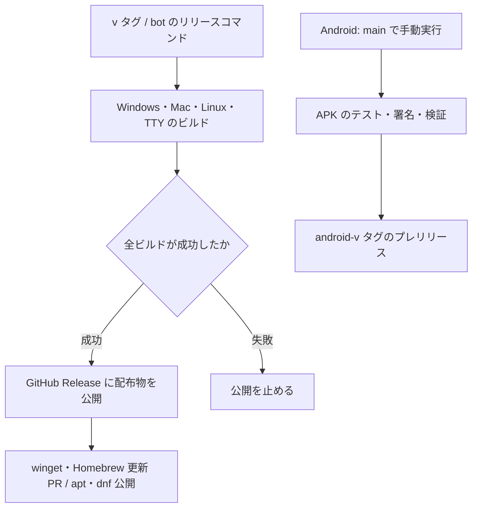

# リリースの手順

デスクトップ・TTY は `v<版>`、Android は `android-v<版>` と別に公開します。配布物の作り方は [release.yml](../../.github/workflows/release.yml) と [android-release.yml](../../.github/workflows/android-release.yml) が基準です。



## 版を出す

1. 版を上げる
   - `src/Directory.Build.props` の `<Version>`
   - `mac/Resources/Info.plist` の `CFBundleShortVersionString` (プレリリースの接尾辞を除いた `X.Y.Z`。bot が照合する) と `CFBundleVersion` (バンドルのビルド番号)。ビルドしたアプリの表示用 `CFBundleShortVersionString` は `mac/build.sh` が Core と同じ版で書き換える
   - 通貨の換算に使うレートを作り直す: `node tools/make-exchange-rates.mjs` (欧州中央銀行の参照レートを `dictionaries/exchange-rates.txt` に書く。通貨換算の候補で使い、利用時にはレートを取りに行かない)
   - `docs/release-notes/<版>.md` にリリースノートを書く (その版で変わった点だけを書く)。配布物に同梱し、更新したあとの初めての起動で Meltype (Windows) が見せる。GitHub のリリースの本文にも同じものを使う。タグのビルドでは、このファイルが無ければ Windows 版のビルドが止まる
2. コミットして main に入れ、タグを付けて push する (例: `git tag v1.7.2 && git push origin v1.7.2`。準備した版に置き換える)
3. 配布物は下の表のとおりです。タグの push で `.github/workflows/release.yml` が動き、Windows (windows.yml)・Mac (mac.yml)・Linux (linux.yml)・端末版 (tui.yml) の配布物を作って、全部できたらリリースに付ける。どれかが失敗したら、どの配布物も付けず、下の Homebrew・apt・dnf にも出さない
4. リリースのページの本文が `docs/release-notes/<版>.md` と同じか確かめる (bot を使うと、そのファイルを本文にした下書きまで自動で作ります。下の「bot でリリースする」)。リリースのページだけ書き直すと、アプリで見せる本文と食い違うので、直すときはファイルも直す
5. 使っている人の Meltype (Windows) は、自動で新しい版に更新されます (`Meltype-<版>-setup.exe` をダウンロードし、次のサインインのときに実行する)

### 配布物

`<版>` はリリースタグから `v` を除いた版です。Mac・Linux はプレビュー版です。`.deb`・`.rpm` のプレリリースの版は `1.2.2-pre.2` なら `1.2.2~pre.2` にします。

| 環境・形式 | ファイル名 | 用途 |
| --- | --- | --- |
| Windows | `Meltype-<版>-setup.exe` | 通常インストール・自動更新・winget |
| Windows ポータブル | `Meltype-<版>-windows-portable.zip` | 展開して起動。データは exe の隣 |
| Windows 互換 zip | `Meltype-<版>-windows.zip` | 1.6.0 以前の自動更新用。setup.exe と実行用 install.ps1 |
| Mac (Apple シリコン) | `Meltype-<版>-mac.zip` | 入力ソースと設定アプリ |
| Mac DMG (Apple シリコン) | `Meltype-<版>-mac.dmg` | インストーラー (Install Meltype) 入りのディスクイメージ |
| Linux x86_64 / ARM64 | `Meltype-<版>-linux.zip` / `Meltype-<版>-linux-arm64.zip` | ビルド済みのフォルダー |
| Debian 系 amd64 / arm64 | `meltype_<版>_amd64.deb` / `meltype_<版>_arm64.deb` | IBus・fcitx5 用のパッケージ |
| Fedora・RHEL 9 系 | `meltype-<版>-1.x86_64.rpm` / `meltype-<版>-1.aarch64.rpm` | 本体。RHEL 9 系は IBus |
| Fedora fcitx5 | `meltype-fcitx5-<版>-1.x86_64.rpm` / `meltype-fcitx5-<版>-1.aarch64.rpm` | fcitx5 アドオンの別パッケージ |
| TTY x86_64 / ARM64 | `Meltype-<版>-tty-linux.zip` / `Meltype-<版>-tty-linux-arm64.zip` | pty で使う端末版 |

公開後に Homebrew Cask の更新 PR を作り、取り込むと `Casks/meltype.rb` が新しくなります。正式版では winget の更新 PR も作ります。apt・dnf のリポジトリは GitHub Pages へ公開します。署名鍵が未設定ならリポジトリの公開ジョブは失敗します。

Windows の [コード署名](../CODE-SIGNING.md) と [SignPath テスト署名の設定手順](../SIGNPATH-SETUP.md)。テスト署名は独立した手動ワークフローで、現在の配布手順は変更しません。

### bot でリリースする

版を上げて main に入れたあと、Issue か Pull Request のコメントの 1 行目に、管理者 (admin / maintain) が次のように書きます。

- `/release 1.2.3` … 通常の版
- `/pre-release 1.2.3-pre.1`・`/pre-release 1.2.3-rc.1` … プレリリース (リリース候補は `rc`)

bot は、main の `src/Directory.Build.props` が指定した版、`Info.plist` が接尾辞を除いた版と合っているかを確かめ (版の上げ忘れを防ぐため、合っていなければ止めます)、`docs/release-notes/<版>.md` があるかを確かめ (無ければ止めます)、タグ `v1.2.3` とリリースの下書き (本文はそのファイル) を作って、そのタグで release.yml を始めます。ビルドが終わると、release.yml が下書きに配布物を付けて公開します。

### テスト版の配布物を作る

Actions の画面で release.yml をブランチに対して手で実行 (Run workflow) すると、Windows・Mac・Linux・TTY のテスト版の配布物を実行結果の Artifacts に置きます (リリースには付けません)。1 つの OS だけなら、windows.yml・mac.yml・linux.yml・tui.yml を手で実行します。

### Android のプレビューを出す

[Android preview release](https://github.com/yksr-melt/Meltype/actions/workflows/android-release.yml) を `main` で手動実行し、版を `0.1.0-preview.1` の形式で指定します。署名付きの `Meltype.apk` を `android-v<版>` の Pre-release に公開します。署名用の Secrets と更新時の注意点は [Android の署名・配布手順](../../android/docs/SIGNING-DISTRIBUTION.md) を参照してください。

## 同梱の .NET の更新

配布物の .NET の版は、どこにも固定していません。ビルドのたびに setup-dotnet (`10.0.x`) がその時の最新の SDK とランタイムを入れます。
Windows は `Build-Package.ps1` が、入っている最新の 10.0 のランタイムを `app\dotnet` に同梱し、Mac・Linux は NativeAOT で組み込みます。
なので、.NET に新しいパッチ (セキュリティの修正など) が出たら、コードを変えずに版を上げてリリースし直せば済みます。

`.github/workflows/dotnet-update.yml` が毎週水曜日に、最新のリリースのポータブル版 zip に入っている版と、Microsoft が公開している最新の版を比べます。
新しい版が出ていれば「同梱の .NET を <版> に更新する (リリースし直す)」の Issue を立てます (Actions の画面から手で実行することもできます)。
.NET のメジャー版を上げる (net10.0 → net11.0) ときは、`*.csproj` の `TargetFramework` と、ワークフローの `dotnet-version` を手で変えます。

## Windows の署名

通常の配布では `windows.yml` が `Build-Package.ps1 -Step Build` でビルド・自己診断し、別の step で `-Step Sign` を実行します。秘密 `SIGN_PFX_BASE64` と `SIGN_PASSWORD` があれば PFX で署名し、無ければ未署名のパッケージを作ります。SignPath は [独立したテストワークフロー](../SIGNPATH-SETUP.md) です。

署名の秘密を渡す step ではビルド済みのアプリを実行しません。ポータブル版は署名後の app を秘密のない step で再利用し、自己診断と Defender 検査を行ってから成果物として保存します。

## GitHub の設定

- Settings → Security → **Private vulnerability reporting** を ON にする ([SECURITY.md](../../SECURITY.md) の報告先)
- Settings → Rules → Rulesets で main の ruleset を作り、必須のチェック (Require status checks to pass) に **test**・**core**・**精度の比較** を入れる (「CLA」は入れない。同意の確認はレビューする人がする)
- (任意) bot の名前を変える: GitHub App を作り、変数 `BOT_APP_ID` と秘密 `BOT_APP_PRIVATE_KEY` を登録する

## パッケージマネージャー

リリースの配布物から、winget・Homebrew のマニフェストを作れます。Linux の .deb と .rpm は linux.yml が作ります。

```
node packaging/make-manifests.mjs 1.2.0 dist/Meltype-1.2.0-mac.zip dist/Meltype-1.2.0-setup.exe
```

`dist/manifests/` にできたものを出します。

- **winget**: `winget/manifests/...` を [microsoft/winget-pkgs](https://github.com/microsoft/winget-pkgs) に Pull Request で出す (`winget validate` で確かめてから)。審査があり、署名の無い実行ファイルは止められることがあります
  - インストーラー (このユーザーだけに入れる・管理者権限なし) のマニフェストです。Meltype の自動更新と同じインストーラーなので、Meltype IME・起動時の起動が入ります。`winget upgrade` (サイレント実行) でも、Meltype IME の DLL が変わっていれば管理者権限の確認が出ます
  - **2 つ目の版からは自動**: 最初の版が取り込まれたら、`microsoft/winget-pkgs` をフォークし、`public_repo` の権限のトークンを秘密 `WINGET_TOKEN` に登録します。以後は正式版のリリースのたびに、release.yml が配布物を付けたあと `.github/workflows/winget.yml` が新しい版の Pull Request を出します (`WINGET_TOKEN` が無ければ失敗します)。使う人は `winget install Yukishiro.Meltype` / `winget upgrade Yukishiro.Meltype`
- **Homebrew Cask**: タグのリリース時に `Casks/meltype.rb` の更新 PR が自動で作られます。PR を main に入れると、新しい版をこのリポジトリからインストールできます。このリポジトリを tap として登録します:
  ```bash
  brew tap yksr-melt/Meltype https://github.com/yksr-melt/Meltype.git
  brew install --cask yksr-melt/Meltype/meltype
  ```
  次回から `brew upgrade --cask meltype` で更新できます。Mac の zip から cask を作る場合は `node packaging/make-manifests.mjs 1.2.0 dist/Meltype-1.2.0-mac.zip` です
  - cask は Meltype.app を `~/Library/Input Methods` に入れ、`mac/install.sh` と同じく、隔離属性を外す・入力ソースに登録する・GUI のセッションで起動するところまでします。`brew upgrade` で更新、`brew uninstall --cask meltype` で外せます (`--zap` で設定と学習データも)
  - 署名と公証 (mac.yml の秘密) が無い版は、自分用の署名 (ad hoc) です。cask は隔離属性を外しますが、Homebrew の本家 (homebrew/cask) には出せません (自分の tap なら使えます)
- **apt (.deb)**: linux.yml が amd64 / arm64 の `.deb` を作り、release.yml がリリースに付けます。署名鍵を登録すると、release.yml が署名付き apt リポジトリを GitHub Pages に自動公開します。
  - 初回だけ GitHub の Settings → Pages → Build and deployment → Source を「GitHub Actions」にします
  - Settings → Environments → `github-pages` → Deployment branches and tags で、タグのルール `v*` を許可します (リリースタグからの公開に必要です)
  - Linux / WSL で GPG 鍵を作り、できた Base64 の文字列を Actions secret `APT_SIGNING_KEY_B64` に登録します。秘密鍵はコミットしません:
    ```bash
    gpg --batch --pinentry-mode loopback --passphrase '' --quick-generate-key "Meltype APT repository" rsa4096 sign 0
    fingerprint="$(gpg --batch --with-colons --list-secret-keys "Meltype APT repository" | awk -F: '$1 == "fpr" { print $10; exit }')"
    gpg --batch --pinentry-mode loopback --passphrase '' --armor --export-secret-keys "$fingerprint" | base64 -w0 > meltype-apt-signing-key.b64
    ```
    GitHub Settings → Secrets and variables → Actions で `APT_SIGNING_KEY_B64` を作り、ファイルの内容を登録します
  - 使う人は、次の設定を一度行うと `sudo apt update && sudo apt upgrade` で更新できます:
    ```bash
    sudo install -d -m 0755 /etc/apt/keyrings
    curl -fsSL https://yksr-melt.github.io/Meltype/apt/meltype-archive-key.asc | sudo tee /etc/apt/keyrings/meltype-archive-key.asc >/dev/null
    sudo chmod 0644 /etc/apt/keyrings/meltype-archive-key.asc
    sudo tee /etc/apt/sources.list.d/meltype.sources >/dev/null <<'EOF'
    Types: deb
    URIs: https://yksr-melt.github.io/Meltype/apt
    Suites: stable
    Components: main
    Architectures: amd64 arm64
    Signed-By: /etc/apt/keyrings/meltype-archive-key.asc
    EOF
    sudo apt update
    sudo apt install meltype
    ```
- **dnf (.rpm)**: linux.yml が x86_64 / aarch64 の `meltype` と `meltype-fcitx5` の `.rpm` を Fedora 44 で作り、AlmaLinux 9 で `meltype` を入れて確かめて、release.yml がリリースに付けます。apt と同じ署名鍵 (`APT_SIGNING_KEY_B64`) で署名した dnf リポジトリを、apt リポジトリと一緒に GitHub Pages の `/rpm` に公開します (Pages の設定は apt と共通です)。
  - 使う人は `sudo dnf config-manager addrepo --from-repofile=https://yksr-melt.github.io/Meltype/rpm/meltype.repo` (RHEL 9 系は `sudo dnf config-manager --add-repo https://yksr-melt.github.io/Meltype/rpm/meltype.repo`) を一度行うと、`sudo dnf upgrade` で更新できます

